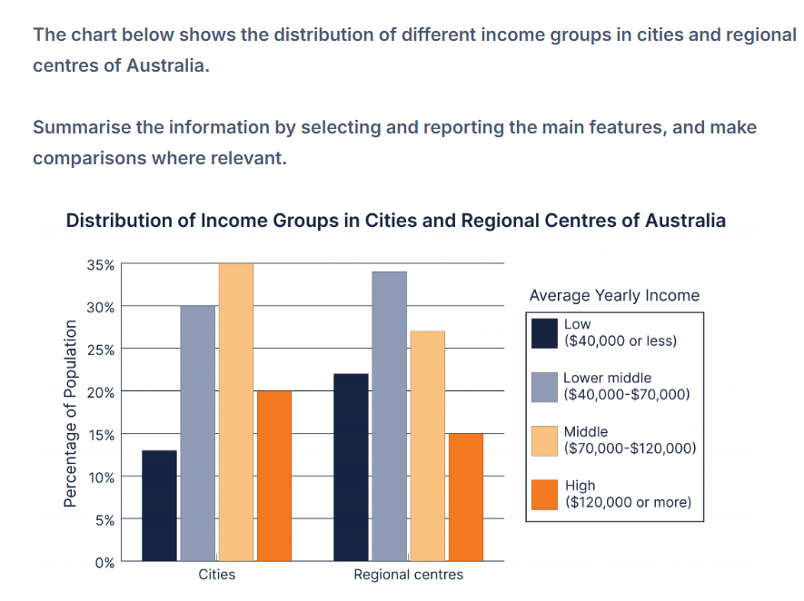

# BC0: income groups distribution

## Model 1

The bar chart **compares the proportions** of residents **belonging to** four annual income groups in Australian cities and regional centres. Overall, the two middle-income **categories accounted for** the **largest share** of the population in both areas. However, regional centres **had greater proportions** of low- and lower-middle-income residents, wheares middle- and high-income earners **were more prevalent** in cities.

In cities, the middle-income group was the largest, **representing** 35% of the population, **followed by** lower-middle earners at 30%. The **corresponding figures** in regional centres were approximately 27% and 34%, meaning that lower-middle-income residents **formed the largest group in** these areas.

A similar geographical contrast **can be seen** at the two ends of the income scale. High-income earners **accounted for** 20% of city residents, **compared with** only 15% in regional centres. **Conversely**, the low-income group **constituted** approximately 22% of the population in regional centres, considerably higher than **the 13% recorded** in cities

### Grammar keys

- **account for …. proportions**
- **constitute …**
- **make up … shares**

→ *A accounts for X% of B, making this ….*

- **follow a comparable pattern**
- **show a similar pattern**
- **display a similar pattern**

→ *The two income groups **show** contrasting **patterns***

- **high-income earners**
- **people on high incomes**
- **people earning more than $120000**

→ ***high-income earners constitute** approximately 37% of the population in the cities.*

---

## Model 2

The bar chart compares the proportions of people in four annual income groups living in Australian cities and regional centres. Overall, lower-middle- and middle-income earners **made up the majority of** the population in both areas. However, regional centres had higher proportions of people in the two lower **income brackets**, whereas cities **had larger shares** of middle- and high-income residents.

In cities, middle-income earners **formed the largest group**, at 35%, followed by lower-middle-income residents at 30%. The **pattern was reversed** in regional centres, where the lower-middle group was the largest at approximately 34%, while middle-income earners **accounted for** around 27%.

The low- and high-income **categories** were smaller in both locations. Low-income residents **represented** only 13% of the population in cities, **compared with approximately** 22% in regional centres. **By contrast**, high-income earners **accounted for** 20% of city residents, five percentage points more **than the corresponding figure for** regional centres.
