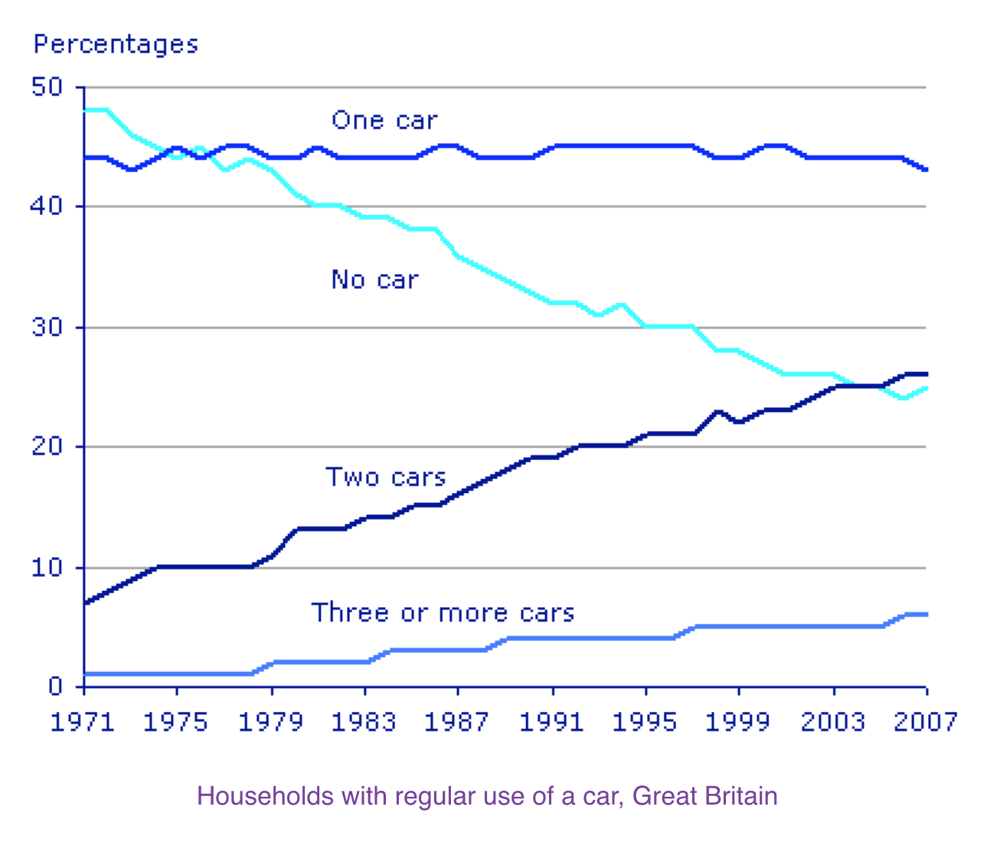

# LG0: household regular car ownership

---

[LG1: growth rate in Algeria, China, and Argentina](lg1-growth-rate-in-algeria-china-and-argentina-3d5e5c39.md)

***The graph below gives information about car ownership in Britain from 1971 to 2007.***

Model 1: 

The line graph **compares the percentages of households** in Great Britain **with regular use of different numbers of cars** between 1971 and 2007. Overall, **car availability** increased over the period: the proportions of households with two or more cars rose, while the percentage with no car **declined markedly**. By contrast, one-car households **remained relatively stable**.

In 1971, households without a car **formed the largest group**, at approximately 48%, **compared with around 44% for those** with one car. However, **the former figure ~~fell steadily~~ followed a broadly downward trend** over the following decades **to about** 25% in 2007, **while the latter fluctuated only slightly** and **finished at roughly** 43%.

The **opposite pattern can be seen among** households with multiple cars. The **proportion with two cars increased substantially overall** from about 7% to 26%, **eventually overtaking the no-car category near the end of the period**. Meanwhile, households with three or more cars **remained** the smallest group **throughout**, although their share rose gradually from around 2% to 6%.

---

Model 2: 

The graph shows **changes in the number of cars** per household in Great Britain **over a period of 36 years**.

Overall, **car ownership** in Britain increased between 1971 and 2007. In particular, the percentage of **households with two cars** rose, **while the figure for** households without a car fell.

In 1971, **almost half of** all British households did not have regular use of a car. Around 44% of households had one car, but only about 7% had two cars. It was uncommon for families to own three or more cars, **with around 2%** of households **falling into this category**.

The one-car household **was the most common type** from **the late 1970s onwards**, although there was **little change in the figures for** this category. The **biggest change was seen** in the proportion of households without a car, which **fell steadily** over the 36-year period to around 25% in 2007. In contrast, the proportion of two-car families rose steadily, **reaching about 26**% in 2007, and the proportion of households with more than two cars rose **by around 5%.**

---

My attempt 1:

The line graph compares the proportions of households in Great Britain with regular access to different numbers of cars from 1971 to 2007.

Overall, car availability followed a ~~broad increasing trend~~ broadly upward trend. The proportion~~s~~ of households without a car dropped significantly, while the figure for two cars increased markedly. Additionally, one-car category overtook the no-car category ~~from~~  in the mid-1970s ~~onwards~~ and remained larger thereafter, while households with three or more cars remained by far the least common throughout.

In 1971, almost half of British households did not have regular access to cars, ~~standing at~~ accounting for approximately 48%. This figure was followed closely by that of the one-car category, at around 44%. ~~On the contrary~~, By contrast, the shares of the multi-car groups were much smaller, with only about 7% having two cars and just above 1% having three or more.

The ~~number~~ proportion of households without a car then decreased markedly to approximately 25% by 2007. Meanwhile, the one-car category ~~showed small fluctuations from around 43% to 45% until the end.~~ , remained broadly stable, fluctuating within a narrow range of approximately 43-45%. The proportions of households with two cars, however, followed an ~~contrastive~~ upward trend, marginally overtaking the no-car group ~~households without cars~~ near the end. The figure for the three-or-more-car~~s~~ group rose ~~steadily~~ gradually to around 7% in 2007, but remained the least common category throughout.