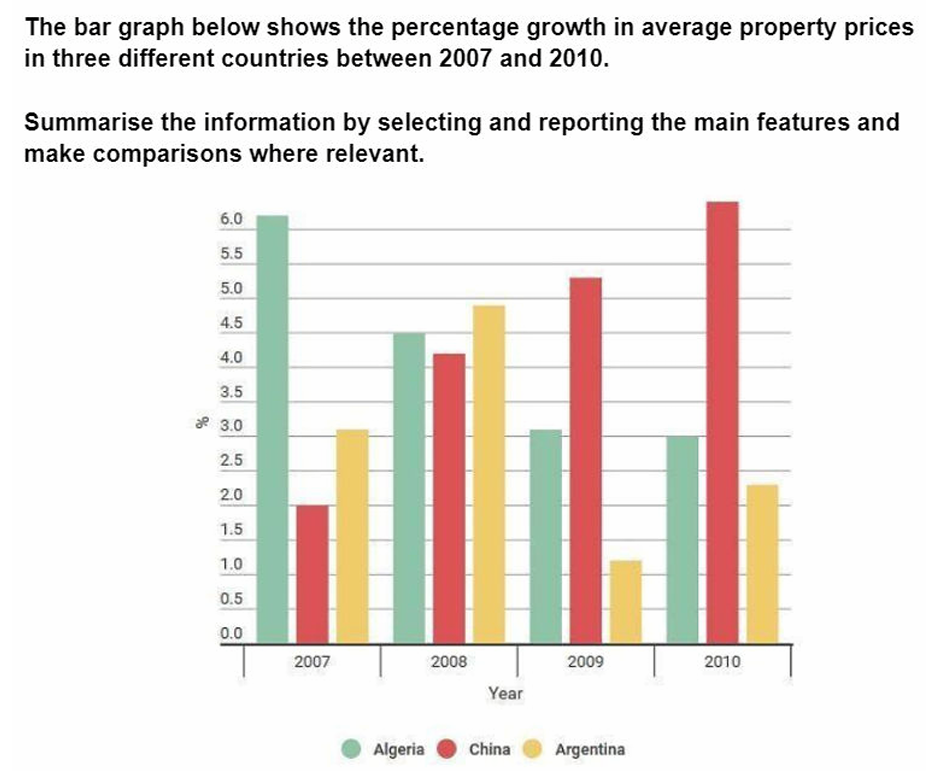

# LG1: growth rate in Algeria, China, and Argentina

Model 1:

The bar chart **compares the percentage growth** in average property prices in Algeria, China and Argentina between 2007 and 2010.

Overall, Algeria **recorded the highest growth rate at the start of the period**, whereas China rose steadily to **become the leading country by** 2010. By contrast, Argentina **experienced considerable fluctuation**, while Algeria’s growth rate **declined overall**.

In 2007, property prices in Algeria grew by just over 6%, compared with only about 2% in China. However, the two countries **then followed opposite trends**. Algeria’s growth rate **fell steadily** to around 3% in 2010, **while the figure for China increased each year**, **reaching nearly 6.5%** by the end of the period.

Argentina **showed a less consistent pattern**. Its growth rate **stood at just over** 3% in 2007 and **peaked at almost** 5% the following year. It then **dropped sharply to a low of just over** 1% in 2009 **before recovering to** approximately 2.3% in 2010.

---

My attempt 1:

The bar graph compares the ~~changes in average property prices growth rates~~  growth rates of average property prices in Algeria, China, and Argentina from 2007 to 2010.

Overall, Algeria began with the highest growth rate and subsequently followed a consistent downward trend, whereas China started ~~rather modest~~ at the lowest level and rose steadily over the years to ~~become the leading country at the end~~ record the highest rate in 2010. Meanwhile, Argentina’s ~~figure~~ rate decreased moderately, despite ~~experiencing some significant fluctuations~~ fluctuating significantly.

In 2007, average property prices grew fastest in Algeria ~~increased the most rapidly among the three countries~~, at approximately 6.2% ~~annually~~. This figure started to fall considerably in the following years, reaching just above 3% and exactly 3% in 2009 and 2010 respectively. In contrast, China’s growth rate initially stood at just 2%, after which it ~~increased drastically~~ rose markedly ~~and reached a high of roughly~~  to approximately 6.5% ~~at the end.~~ in 2010.

Turning to Argentina, its growth rate began with just over 3%. It then peaked at approximately 4.9% in the following year. After this, the figure fell sharply to around 1.2% before recovering to roughly 2.3% in 2010.

---

Model 2:

The bar chart illustrates the annual growth rates of average property prices in Algeria, China and Argentina from 2007 to 2010.

Overall, Algeria and China **displayed opposing trends**. Algeria began with the highest rate but **declined throughout the period**, whereas China rose each year and ranked first by 2010. Argentina fluctuated considerably and ended with the lowest growth rate.

In 2007, average property prices grew by approximately 6% in Algeria, twice the rate recorded in Argentina and more than three times China’s figure of just under 2%. Algeria’s rate then fell substantially to around 4.5% in 2008. It **declined further** to approximately 3% in 2009 and r**emained close to this level in the final year.**

By contrast, China’s property-price growth more than doubled to just over 4% in 2008, before climbing to approximately 5.2% and 6.3% in the following two years. Argentina initially rose from about 3% to a peak of roughly 4.8% in 2008. I**ts rate then plunged** to around 1% in 2009 **before recovering partially to just over 2%** by 2010.