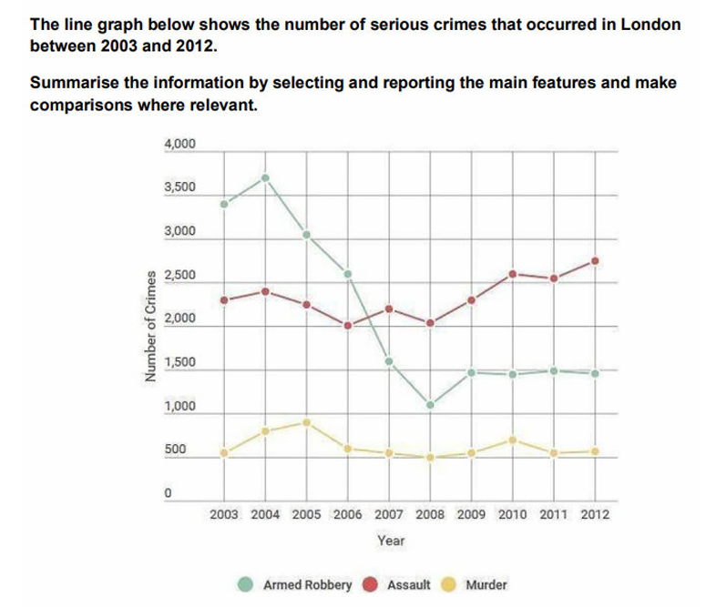

# LG2: number of crimes in London

---

## Model 1

The line graph **compares the number of armed robberies, assaults and murders recorded** in London between 2003 and 2012.

Overall, armed robbery **declined substantially over the period**, whereas the number of assaults **increased overall despite some fluctuations**. Murder **remained far less common than the other two offences** and **changed relatively little by comparison**.

Armed robbery **was initially the most prevalent crime**, at around 3,300 cases in 2003. After peaking at approximately 3,600 the following year, the figure **fell sharply**, **reaching a low of** about 1,000 in 2008. It **then recovered** to roughly 1,400 cases and **remained close to this level until 2012.**

Assaults, by contrast, fluctuated ~~around~~ between 2,000 and 2,300 cases between 2003 and 2009 before rising to approximately 2,700 by the end of the period, **making this the most common crime in** 2012. Murder **peaked at roughly** 800 cases in 2005, **before falling and subsequently fluctuating at around** 400–600 cases **for the rest of the period.**

---

### Takeaways
- **compares the number of armed robberies, assaults and murders recorded**
→ Introduces the subject of the graph clearly and formally.
- **declined substantially over the period**
→ Describes a strong downward trend across time.
- **increased overall despite some fluctuations**
→ Shows a general upward trend but acknowledges irregular changes.
- **remained far less common than the other two offences**
→ Highlights relative frequency, useful for comparison.
- **changed relatively little by comparison**
→ Indicates stability compared to other variables.
- **was initially the most prevalent crime**
→ Establishes starting point dominance in the data.
- **fell sharply**
→ Expresses a sudden and significant decrease.
- **reaching a low of**
→ Specifies the lowest point in the trend.
- **then recovered**
→ Signals a rebound after decline.
- **remained close to this level until 2012**
→ Shows stability after change.
- **making this the most common crime in**
→ Draws a conclusion about ranking at the end of the period.
- **peaked at roughly**
→ Marks the highest point in the data.
- **before falling and subsequently fluctuating at around**
→ Describes a peak followed by decline and irregular variation.
- **for the rest of the period**
→ Indicates long-term continuation of a trend.
    

### Task-specific phrase bank

| Phrase | Exact usage condition | Warning / boundary | Example |
| --- | --- | --- | --- |
| **was initially the most common offence** | Use when a category ranks first at the beginning. | Verify that it is actually above every other series. | Armed robbery was initially the most common offence. |
| **was overtaken by** | Use when another series crosses above it. | State the correct crossover year. | Armed robbery was overtaken by assault in 2007. |
| **reached a peak of X** | Use for the clear maximum of a series. | A lower secondary rise is not another highest value. | Armed robbery reached a peak of 3,600. |
| **fell to a low of X** | Use when a series reaches its minimum following a decline. | Do not use merely because the value is low relative to another category. | The figure fell to a low of 1,000. |
| **recovered to X** | Use when a value rises after a preceding decline. | Do not use for an increase that has no earlier fall. | Armed robbery recovered to around 1,400. |
| **rose overall despite some fluctuations** | Use when the endpoint is higher but the line contains reversals. | Do not replace this with *rose steadily*. | Assault rose overall despite some fluctuations. |
| **ended close to its starting level** | Use when the first and final values are similar. | This does not mean the series remained stable throughout. | Murder ended close to its starting level. |
| **a smaller secondary peak** | Use for a later local maximum below the overall peak. | Do not call it *the highest* or say the series peaked again at the same level. | A smaller secondary peak occurred in 2010. |
| **remained close to this level thereafter** | Use when subsequent values stay within a narrow range. | Do not use if another material rise or fall follows. | Armed robbery remained close to this level thereafter. |

---

## My attempt 1

The line graph illustrates ~~the~~ changes in the numbers of armed robber~~y~~ies, assaults, and murders committed in London from 2003 to 2012.

Overall, armed robbery was the most common crime at the beginning, but its figure dropped significantly and remained relatively stable near the end. By contrast, assault increased noticeably overall despite some fluctuations and become the most common offence. Meanwhile, murder remained by far the least common crime throughout and ended close~~ly~~ to its initial level.

In 2003, the number of arm robberies stood at nearly 3500 ~~cases.~~ It then rose ~~rapidly~~ to approximately 3700 ~~cases~~ in the following year before dropping sharply to just over 1000 ~~cases~~ in 2008. This figure subsequently ~~then~~ recovered partially to around 1500 ~~cases~~ and ~~retained comparably similar levels~~  remained at a broadly similar level until 2012. The corresponding figure for assaults started ~~off~~ more modestly, at around 2300 cases ~~in 2003~~, ~~climbed marginally to roughly 2400 cases in 2004 before declining and fluctuating within a narrow range between 2000 cases and 2300 cases from 2005 to 2009~~. After fluctuating between approximately 2000 and 2300 until 2009, it increased overall and reached about 2700 in 2012. ~~This value then increased broadly and reached approximately 2700 cases 2012.~~

Turning to ~~the~~ murder ~~category~~, ~~its number~~ the figure began with just over 500 cases and climbed ~~to its first peak at~~ to a peak of around 900 ~~cases~~ in 2025. Then it ~~decreased broadly~~ declined overall and ended at roughly 550 cases in 2012 despite a ~~slight~~ brief recovery ~~from 2009 to 2011.~~  in 2010.

