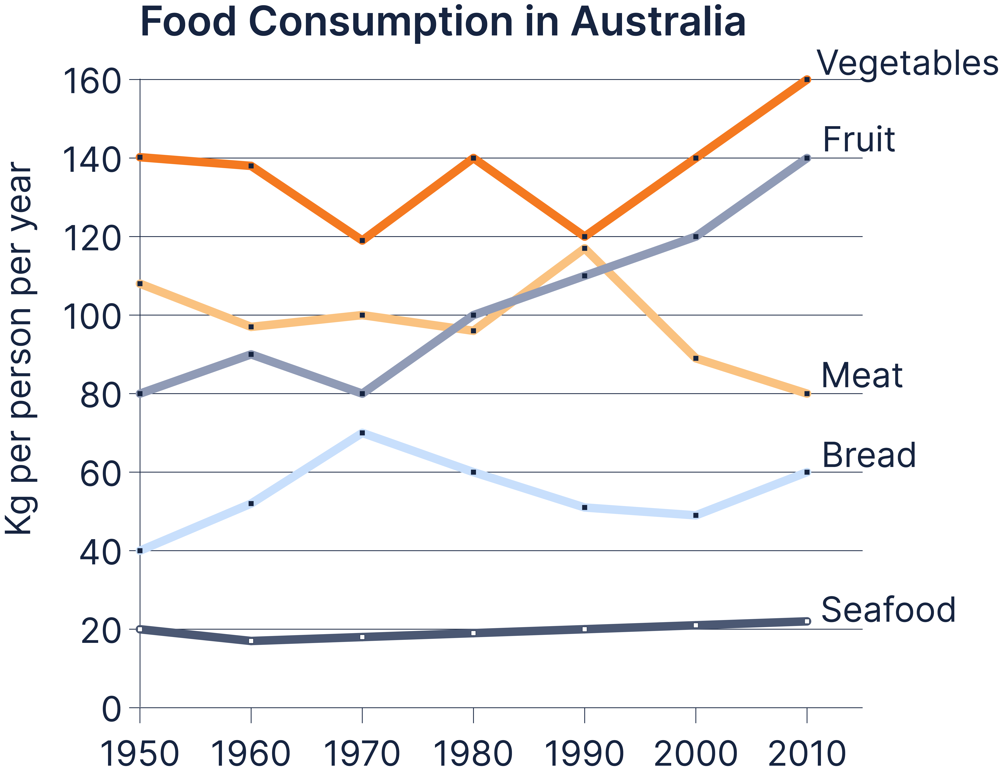

# LG3: food consumption in Australia

**The graph below shows food consumption in Australia between 1950 and 2010.**

**Summarise the information by selecting and reporting the main features, and make comparisons where relevant.**

The line graph compares **per-capita consumption** of five food categories in Australia between 1950 and 2010, **measured in kilograms** per year.

Overall, vegetables remained **the most widely consumed** food throughout the period and **finished at** a record high, while fruit **showed substantial long-term growth**. By contrast, meat consumption **declined overall after considerable fluctuation**. Bread also fluctuated but **rose moderately** across the period, whereas seafood remained by far the least consumed category and changed very little.

Vegetable consumption **began at** 140 kg per person in 1950 and **remained close to this level** in 1960, **before falling to** approximately 120 kg in 1970. It subsequently **alternated between about 120 and 140 kg until 2000**, after which it **rose sharply to** 160 kg in 2010. Fruit **followed a clearer upward trend**: after increasing from 80 kg to 90 kg between 1950 and 1960 and briefly returning to 80 kg in 1970, consumption **climbed steadily** to 140 kg by the end of the period.

Meat consumption **started at just over** 100 kg and **fluctuated around this level** for **several decades**, **reaching a peak of almost** 120 kg in 1990 **before dropping markedly** to 80 kg in 2010. Bread rose from 40 kg in 1950 to 70 kg in 1970, then declined to around 50 kg in 2000 before recovering to 60 kg. Seafood **showed the least variation**, **falling slightly below** 20 kg in 1960 and then increasing gradually to just over 20 kg by 2010.

---

- Take-aways
    - **per-capita consumption**
    → Specifies measurement per person, adds precision to data description.
    - **measured in kilograms**
    → Clarifies the unit of measurement, essential for accuracy.
    - **the most widely consumed**
    → Highlights dominance or popularity of a category.
    - **finished at**
    → Indicates the final value at the end of the period.
    - **showed substantial long-term growth**
    → Describes a strong upward trend sustained over time.
    - **declined overall after considerable fluctuation**
    → Combines both irregular changes and a downward trend.
    - **rose moderately**
    → Expresses a small but noticeable increase.
    - **began at**
    → Establishes the starting point of a trend.
    - **remained close to this level**
    → Shows stability around a certain value.
    - **before falling to**
    → Signals a drop after a stable or rising phase.
    - **alternated between about**
    → Describes repeated variation between two values.
    - **rose sharply to**
    → Indicates a sudden and significant increase.
    - **followed a clearer upward trend**
    → Highlights a consistent rise compared to other categories.
    - **climbed steadily**
    → Shows gradual, continuous growth.
    - **started at just over**
    → Provides a precise starting value with slight approximation.
    - **fluctuated around this level**
    → Indicates irregular variation near a central value.
    - **several decades**
    → Adds time-scale emphasis, useful for long-term trends.
    - **reaching a peak of almost**
    → Marks the highest point with near precision.
    - **before dropping markedly**
    → Signals a sharp decline after a peak.
    - **showed the least variation**
    → Highlights stability compared to other categories.
    - **falling slightly below**
    → Indicates a small decrease beneath a threshold.

---

My attempt 1:

The line graph illustrates the changes in the amounts of five types of food consumed per person per year in Australia from 1950 to 2010.

Overall, vegetables were consumed in the greatest quantities throughout the period. Additionally, the consumption of fruit, vegetables and bread increased overall, with fruit recording the largest rise. Meanwhile, meat consumption declined despite reaching a peak in 1990. Seafood remained the least consumed category and showed little overall change.

In 1950, vegetable  consumption stood at 140 kilograms per person. After a marginal decline in the following decade, it fluctuated between 120 and 140 kilograms until 2000, before rising to 160 in 2010. Fruit consumption started at 80 kilograms and increased substantially overall to 140, despite returning to its initial value in 1970. Bread began at 40 kilograms and subsequently peaked at around 70 in 1970. It then declined steadily over the next 3 decades before recovering to 60 in 2010.

Meat consumption began at approximately 108 kilograms and fluctuated within a narrower range than vegetables until 1980. The figure then increased sharply to peak at just under 120 in 1990, after which it declined significantly to 80 in 2010. Seafood fell marginally from 20 kilograms, before climbing slowly to finish just above its initial level.

Problem:

