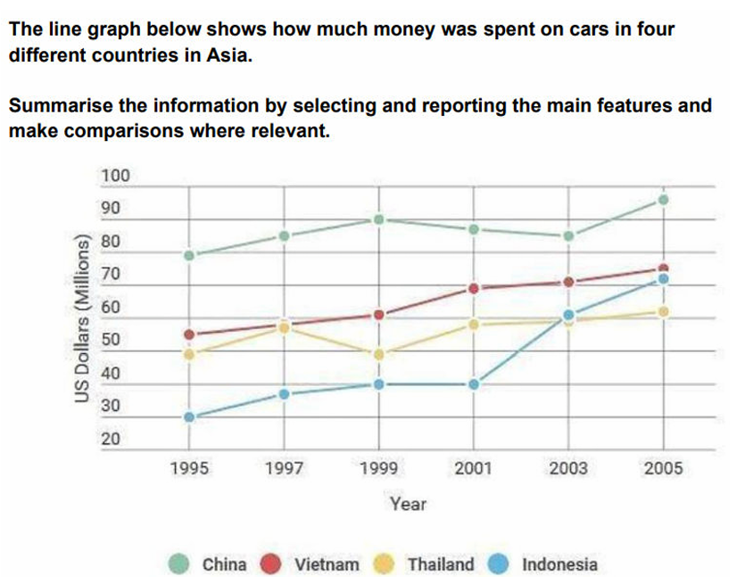

# LG4: car expenditures

---

The line graph shows how much was spent on cars in four Asian countries from 1995 to 2005.
Overall, China **remained the largest market** throughout the period, while car expenditure rose steadily in Vietnam. Indonesia experienced **the most pronounced growth**, especially after 2001, whereas Thailand showed only a modest overall increase **despite fluctuations**.
Spending in China climbed from approximately $75 million in 1995 to a peak of around $87 million in 1999. It **subsequently declined slightly before rebounding to** about $93 million in 2005. Vietnam followed a **simpler upward trajectory**, with expenditure rising consistently from just over $50 million to roughly $72 million.
Thailand’s figure fluctuated **within a comparatively narrow range**. It began at around $45 million, rose and fell over the following years, and finished at just under $60 million. Indonesia, by contrast, started with the lowest expenditure, at approximately $27 million. After increasing gradually to about $37 million in 1999 and **remaining stable until** 2001, it **surged to nearly** $70 million by 2005. This rise allowed Indonesia to **overtake Thailand and finish only slightly below** Vietnam.

---

- Task-specific phrase bank
    
    
    | Phrase | Exact usage condition | Warning / boundary | Example |
    | --- | --- | --- | --- |
    | **recorded the highest expenditure throughout** | Use when one series remains above all others for the full period. | Check every data point, not only the endpoints. | China recorded the highest expenditure throughout. |
    | **followed a steady upward trajectory** | Use when every recorded movement is upward. | Do not use if even one meaningful decline occurs. | Vietnam followed a steady upward trajectory. |
    | **rose overall despite fluctuations** | Use when the final value is higher but the route includes falls. | This is different from *rose steadily*. | Spending rose overall in all four countries. |
    | **peaked at X** | Use when a value reaches a clear maximum before declining. | China’s highest point is actually in 2005, so its 1999 value is better described as a temporary high unless discussing the pre-decline phase. |  |
    | **declined before rebounding to X** | Use when a fall is followed by a substantial recovery. | A rebound requires an earlier decline. | Chinese spending declined before rebounding to $93 million. |
    | **fluctuated within a narrow range** | Use when repeated rises and falls remain between close limits. | State or imply the range accurately. | Thailand fluctuated within a range of $45–59 million. |
    | **remained unchanged until…** | Use when consecutive recorded values are equal. | Do not use merely because the change is small. | Indonesian spending remained unchanged until 2001. |
    | **surged to X** | Use for a large, rapid increase over a relatively short interval. | Avoid it for gradual growth. | Indonesia surged to nearly $70 million. |
    | **overtook X** | Use when one line crosses from below another to above it. | Verify the crossover year. | Indonesia overtook Thailand in 2003. |
    | **narrowed the gap with** | Use when the difference between two series becomes smaller. | It does not necessarily mean a crossover occurred. | Indonesia narrowed the gap with Vietnam substantially. |

---

The line graph ~~gives information about~~ compares the amount~~s of money~~ spent on cars in China, Vietnam, Thailand and Indonesia from 1995 to 2005, measured in millions of US dollars.

Overall, ~~the car expenditures~~ car spending increased ~~across the~~ in four countries ~~increased overall.~~ . China ~~led the chart~~  remained the largest market throughout, while Vietnam~~’s spent rose steadily~~  experienced steady growth. ~~while that of~~ Indonesia ~~climbed more dramatically from 2001 onwards and eventually overtook Thailand near the end, despite started at the lowest level~~. recorded the most dramatic rise, particularly after 2001, and overtook Thailand near the end of the period despite having started at the lowest level.

In 1995, China spent just under $80 million dollars on cars, ~~almost double and triple to  the corresponding figures for Thailand and Indonesia, respectively~~. considerably more than Thailand and nearly three times as much as Indonesia. ~~The figure then~~ Its expenditure rose to 90 million in 1999, ~~followed by a moderate decline to approximately 85 million in 2003~~ declined moderately over the following four years, and then ~~before~~ climbed ~~rapidly~~  sharply to around 96 million in 2005. ~~A much less pronounced pattern can be seen in Vietnam’s expenditure~~, Vietnam followed a smoother upward trend, ~~which rose~~ increasing steadily from 55 million to around 75 million in the end.

~~By contrast, the recorded Thailand’s spent on cars were less stable from 1995 to 2001, during which they alternated between approximately 50 and just under 59 million.~~ Thailand’s figure fluctuated during the first half of the period before rising gradually to just above $60 million in 2005. ~~The figure subsequently rose marginally and reached just above 60 million in 2005. Meanwhile~~, By comparison, Indonesian spending ~~initially stood at just 30 million~~. increased from around $30 million to approximately $40 million between 1995 and 1999 and then remained stable until 2001 ~~During the next 4 years, it increased moderately to 40 million then plateaued for 2 years before soaring and overtook Thailand in 2003 to finish marginally under Vietnam in 2005.~~ It subsequently surged, surpassing Thailand in 2003 and finishing only slightly below Vietnam.

