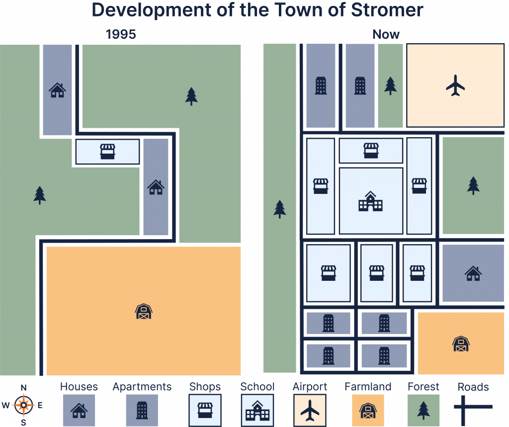

# M0: development of Stromer Town

**The map below shows the development of the town of Stromer between 1995 and now.**

**Summarise the information by selecting and reporting the main features, and make comparisons where relevant.**

---

The two maps **show how** the town of Stromer **has changed since 1995**. Overall, the town has **undergone substantial urban development**, **with** large areas of farmland and forest **replaced by** housing, apartment blocks, shops, a school and an airport. The road network **has also become much more extensive**.

In 1995, most of the southern part of Stromer was **occupied by** farmland, while **extensive forest covered much of** the north and east. There were only two houses, one shop and a **relatively limited road system.**

**At present**, the former farmland has been **greatly reduced** and **is restricted to** the south-eastern **corner**. **Much of this land** has been **redeveloped** with shops, apartment blocks and a house. A school now **occupies the central area**, with several shops nearby.

The forest has also been significantly reduced. An airport has been built in the north-east, while apartment blocks have been **added further west**. Although some forest remains, the town is now dominated by **built-up areas connected by** a much denser road network.

- **was replaced by**
- **was converted into**
- **was demolished**
- **was constructed/built**
- **was expanded**
- **was extended**
- **was relocated**
- **occupied**
- **was situated/located**
- **to the north/south/east/west of**
- **in the north-eastern corner**
- **adjacent to**
- **alongside**
- **remained unchanged**
- **was retained**