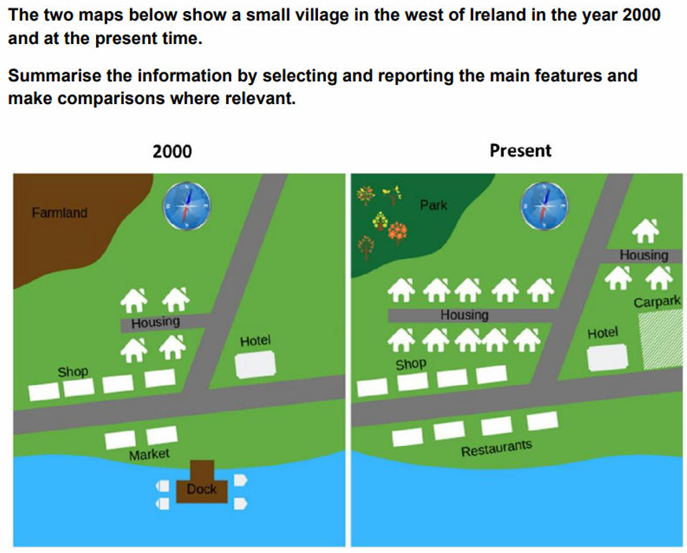

# M1: small village residential development

---

The maps illustrate **how** a small village in western Ireland **has changed since 2000**.
Overall, the village **has undergone considerable residential development**, **together with changes to** its roads and amenities. Farmland, the market and the dock have disappeared, while the shops and hotel remain. A park, restaurants and a car park have been introduced.
In 2000, farmland **occupied the north-western corner**. Four houses stood along a short road **branching west from** the main north–south route, while **shops lined the east–west road**. A hotel **was situated east of** the north–south road. On the coast, a market stood near **a dock extending into the sea**.
Today, the farmland **has been converted into** a park. The western residential road **has been lengthened** and numerous houses have **been added along it**. Another branch, also **serving new housing**, has been **constructed east of** the main road. The hotel and shops **remain in place**, although a car park now **adjoins** the hotel. Finally, restaurants have replaced the market, and the dock has been removed.

## Task-specific phrase bank

| Phrase | Exact usage condition | Warning / boundary | Example |
| --- | --- | --- | --- |
| **has undergone considerable development** | Use when several substantial changes have occurred across a mapped area. | Specify the type of development when possible. | The village has undergone considerable residential development. |
| **has become more residential** | Use when the number or extent of houses has clearly increased. | Do not claim population growth unless figures are given. | The village has become more residential. |
| **occupied the north-western corner** | Use when a feature fills or covers that part of a map. | *In the north-west* indicates location; *occupied* additionally suggests use of the area. | Farmland occupied the north-western corner. |
| **branched west from the main road** | Use when a side road visibly leaves a main route in that direction. | Do not say houses are on the main road if they are actually on the branch. | A short road branched west from the main route. |
| **has been converted into** | Use when the same site changes function. | Use *replaced by* if the focus is on one feature taking another’s place. | The farmland has been converted into a park. |
| **has been extended westwards** | Use when an existing feature becomes longer toward the west. | Use *constructed* for an entirely new road. | The residential road has been extended westwards. |
| **has remained in its original location** | Use when a feature is unchanged in both position and identity. | Do not use if it was rebuilt or relocated. | The hotel has remained in its original location. |
| **now adjoins** | Use when a new feature is directly beside another. | *Adjoins* implies immediate contact or very close adjacency. | A car park now adjoins the hotel. |
| **has replaced the former…** | Use when a new feature occupies the previous site of another. | Confirm that the original feature has disappeared. | Restaurants have replaced the former market. |
| **has been removed** | Use when a feature is absent from the later map and the method is unknown. | This is more neutral than *demolished*. | The dock has been removed. |

---

Model2:

The two maps illustrate **how the layout** of a small village in western Ireland **has changed** since 2000.
Overall, the village has **become considerably more residential**, and its road network has been **enlarged accordingly**. Several amenities have also changed: the farmland and market have been replaced by a park and restaurants, while the dock has disappeared. By contrast, the shops and hotel **remain.**
In 2000, four houses were **arranged along** a short road **extending west from** the main north–south route. Farmland **occupied** the north-western **corner**, while shops and a hotel **stood beside** the east–west coastal road. A market **lay south** of this road, close to a dock **projecting into the sea**.
Today, the western side road extends farther and **is lined with substantially more housing**. A second branch and additional houses have also been built east of the main road. The former farmland **is now** a park, and restaurants **occupy the previous market site**. The dock has been removed, whereas the hotel and shops have **retained their original positions**. A car park has also been constructed directly east of the hotel.