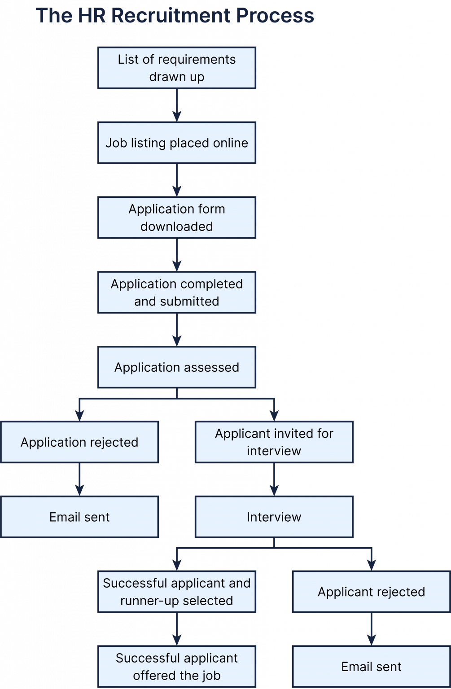

# P0: the HR recruitment process

**The process below shows the Human Resources (HR) recruitment process for a company.**

**Summarise the information by selecting and reporting the main features, and make comparisons where relevant.**

---

## Model answer

The diagram **shows the recruitment procedure followed by** a company's Human Resources department. Overall, the process **starts with** preparing and advertising a **vacancy**, after which applications are assessed and suitable candidates are interviewed. There are two possible rejection points, and only the final successful applicant is offered the job.

Initially, a list of requirements is drawn up and the vacancy is advertised online. Applicants then download, complete and submit an application form, which is subsequently assessed by the HR department. Candidates who fail this initial assessment are rejected and notified by email, while those who are successful are invited to an interview.

Following the interview, unsuccessful candidates are again rejected and sent an email. By contrast, a successful applicant and a runner-up are selected, after which the successful candidate is formally offered the position.
