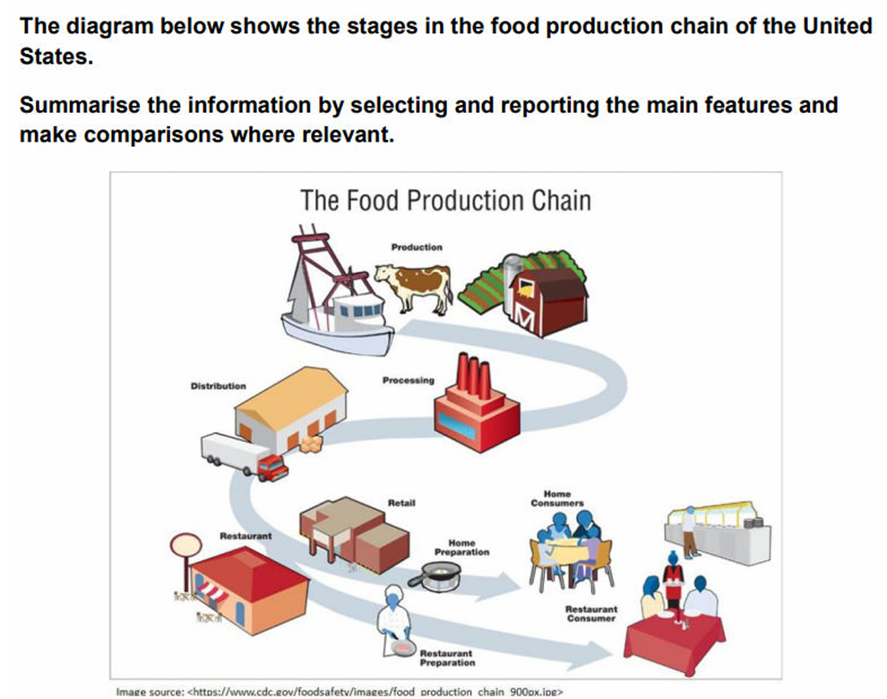

# P1: food production chain

---

## Model answer

The diagram **shows the stages through which** food in the United States **passes** before being consumed.

Overall, food from **fishing**, **livestock farming** and **crop cultivation follows the same** processing and distribution **stages** before **the process divides into** two routes. Food supplied through **retail outlets** is prepared and eaten at home, whereas food delivered to restaurants is prepared and **consumed on the premises**.

Initially, fish are caught, **livestock is raised** and crops are grown. These products are then transported to a **processing plant**, after which the processed food is sent to a **distribution centre**. From there, it is supplied either to retail outlets or to restaurants.

**In the retail route**, the food is **subsequently** prepared at home and consumed by household members. By contrast, food sent to restaurants is prepared there before **being served to diners**. It is then eaten either at a table or from a buffet. Both routes therefore end in consumption, although the location of preparation and eating differs.
