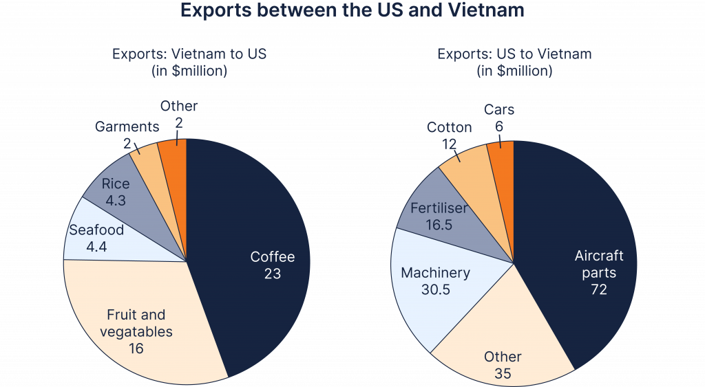

# PC0: exports between the US and Vietnam

**The pie charts below show exports between the US and Vietnam.**

**Summarise the information by selecting and reporting the main features, and make comparisons where relevant.**

The two pie charts compare **the value of goods exported** between Vietnam and the US **across several product categories**, **measured in** millions of dollars.

Overall, Vietnam's exports to the US **were dominated by agricultural products**, particularly coffee and fruit and vegetables. By contrast, US exports to Vietnam were **considerably larger in value** and were **led by** aircraft parts and machinery.

Coffee was Vietnam's **most valuable export** to the US, at $23 million, followed by fruit and vegetables at $16 million. **The remaining categories were substantially smaller**: seafood and rice were **both worth just over** $4 million, while garments and other goods stood at $2 million each.

**In the opposite direction**, aircraft parts were **by far the largest** category, **valued at** $72 million. Other goods and machinery followed at $35 million and $30.5 million respectively, while fertiliser and cotton contributed smaller amounts. Cars **were the least valuable** US export **shown**, at $6 million.

---

- **Take-aways**
    - **be worth … :** *the exported goods from Vietnam to US were worth $145 million…*
    - **be valued at:** *aircraft parts were valued at $72 million, making them the largest category.*
    - **larger in value:** *exports in the “Other” category from the US to Vietnam was larger/greater in value than those from Vietnam to the US*
    - **stood at**
    - **rose/fell to**
    - **increased/decreased by**
    - **accounted for**
    - **was valued at**
    - **was followed by**
    - **remained relatively stable**
    - **fluctuated considerably**
    - **reached a peak of**
    - **recorded the largest increase**
    - **was by far the largest/smallest category**
    - **the corresponding figure was**
    - **in contrast / by comparison / whereas**
    - **overall, the most notable feature is that...**

---

My attempt 1: 

The two pie charts compare exports between the US and Vietnam, measured in millions of dollars.

Overall, the US’ exports to Vietnam are worth significantly higher than that of the other direction. Additionally, coffee and foods constitute the main parts of Vietnam’ exports to the US, whereas the US’ exports to Vietnam are dominated by aircraft parts, machinery and the “Other” category.

The US exports goods valued at $174 million, almost 3 times the value of goods exported from Vietnam to the US, around $60 million. Within the exports category value distribution of the US to Vietnam, aircraft parts account for $72 million, more than a third of the total value. The corresponding shares of 

**The pie charts below show exports between the US and Vietnam.**

**Summarise the information by selecting and reporting the main features, and make comparisons where relevant.**

