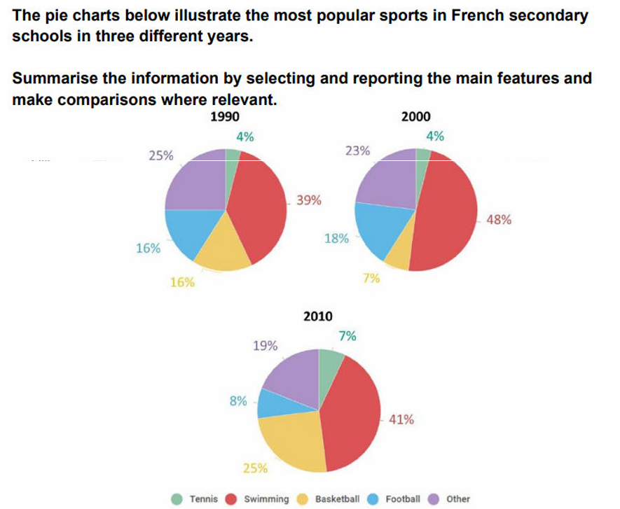

# PC1: sport preferences

---

## Model answer

The three pie charts compare the proportions of French secondary-school pupils **preferring five categories** of sport in 1990, 2000 and 2010.

Overall, swimming **dominated in all three years**, whereas tennis **was consistently the least** popular **choice**. Basketball **underwent the largest change**, rising sharply after 2000 **to rank second** by 2010, while football’s share **fell considerably over the same period.**

Swimming was **selected by** 39% of pupils in 1990. **Its share peaked at** 48% ten years later before declining to 41% in 2010, although it **retained a substantial lead throughout**. Tennis accounted for only 4% in both 1990 and 2000 and then increased slightly to 7%.

Basketball and football **each represented** 16% in 1990, but **their subsequent patterns differed markedly**. Basketball initially fell to 7% in 2000 before climbing to 25% in 2010. Football, by contrast, **edged up to** 18% and then dropped to 8%. Meanwhile, the proportion recorded under “other” sports declined moderately from 25% in 1990 to 19% in 2010. As a result, basketball **overtook this category** to **become the second most popular choice** in the final year.

## Task-specific phrase bank

| Phrase | Exact usage condition | Warning / boundary | Example |
| --- | --- | --- | --- |
| **was consistently the most popular** | Use when one category ranks first in every chart or year. | Do not use if another category overtakes it at any point. | Swimming was consistently the most popular sport. |
| **ranked last in every year** | Use when a category is the smallest throughout. | Check all charts, not only the first and final years. | Tennis ranked last in every year. |
| **accounted for X%** | Use to state a category’s share of a whole. | Use a percentage or proportion, not a raw count. | Swimming accounted for 48% in 2000. |
| **overtook X to become…** | Use when one category moves above another in ranking. | Do not use *replaced* unless the original category disappears. | Basketball overtook “other” to become the second-largest category. |
| **rose by X percentage points** | Use for the absolute difference between two percentages. | A rise from 7% to 25% is 18 percentage points, not 18%. | Basketball rose by 18 percentage points. |
| **more than halved** | Use when the final value is less than half the initial value. | From 18% to 8% is more than a halving; from 16% to 8% is exactly a halving. | Football’s share more than halved after 2000. |
| **followed the opposite pattern** | Use when two categories move in contrasting directions over the same interval. | The trajectories must genuinely contrast. | Football followed the opposite pattern to basketball after 2000. |
| **retained a substantial lead** | Use when the leading category remains clearly ahead. | It requires a meaningful gap over the next-largest category. | Swimming retained a substantial lead throughout. |
| **declined moderately across the period** | Use for a noticeable but not dramatic overall decrease. | Do not use *steadily* unless every recorded interval declines. | The “other” category declined moderately across the period. |
