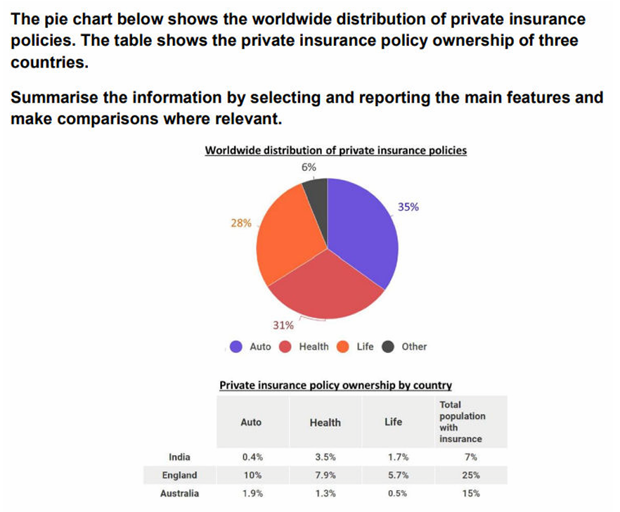

# PC2: private insurance policies

---

## Model answer

The pie chart **presents the worldwide breakdown** of private insurance policies, and the table **compares the proportions** of people **owning such policies** in India, England and Australia.

Overall, auto, health and life insurance **together account for** almost all policies globally, **with** auto coverage **forming the largest category**. England has the highest overall **ownership rate** of the three countries. The global ranking of auto, health and life **is also reproduced** in England and Australia, **but not in India**, **where** health insurance **is the leading type**.

Globally, 35% of private policies cover automobiles, while health and life insurance represent similar shares of 31% and 28%. Other policies **make up the remaining** 6%.

In England, 25% of the population has private insurance, **compared with** 15% in Australia and 7% in India. For **the three specified types**, England records the highest figures, ranging from 5.7% for life insurance to 10% for auto coverage. Auto **also ranks first** in Australia, **although its figure is only** 1.9%. India **shows a contrasting distribution**: health insurance **accounts for** 3.5% of the population, **followed by** life at 1.7% and auto insurance at 0.4%.

## Task-specific phrase bank

| Phrase | Exact usage condition | Warning / boundary | Example |
| --- | --- | --- | --- |
| **accounts for X% of the total** | Use when a category represents a stated share of a whole. | The denominator must be clear. | Auto insurance accounts for 35% of the global total. |
| **together account for…** | Use when combining several category shares. | Add the percentages accurately. | The three principal types together account for 94%. |
| **has the highest ownership rate** | Use when comparing population percentages across locations. | This does not establish the highest absolute number of owners. | England has the highest ownership rate. |
| **mirrors the global pattern** | Use when a country has the same category order as the worldwide distribution. | The complete relevant ranking should match. | Australia mirrors the global pattern. |
| **follows the same ranking** | Use when categories appear in the same descending or ascending order. | Specify which categories if the visual contains additional ones. | England follows the same auto–health–life ranking. |
| **displays a different order** | Use when one location’s ranking differs from the comparison pattern. | Explain the actual order rather than leaving the difference vague. | India displays a different order, with health ranking first. |
| **followed closely by** | Use when the next category is only slightly smaller. | Avoid it when the difference is substantial. | Auto, at 35%, is followed closely by health at 31%. |
| **at much lower levels** | Use when the ranking is similar but the absolute percentages are substantially smaller. | It compares magnitude, not order. | Australia follows the same order at much lower levels. |
| **the corresponding figures were…** | Use to present values in the same category order established previously. | Make the correspondence unmistakable. | The corresponding Australian figures were 1.9%, 1.3% and 0.5%. |
| **a quarter of the population** | Use as an exact alternative to 25%. | Do not use for an approximate figure substantially different from 25%. | A quarter of England’s population has private insurance. |
