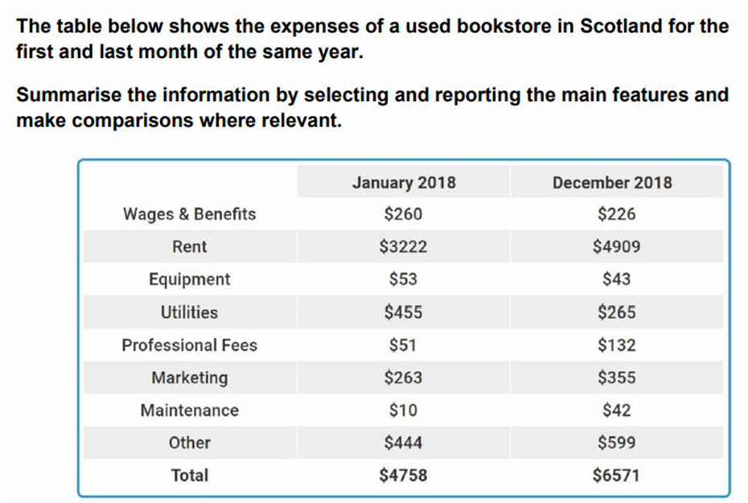

# TB0: Used book expenses

---

> "this is a little bit too short"

## Model answer

The table compares the expenses of a **second-hand bookshop** in Scotland in January and December 2018.

Overall, **total expenditure increased substantially over the year**, **largely because** of **a sharp rise in** **rent**. Spending on wages and benefits, equipment and utilities fell, **whereas all of** the remaining categories increased.

Total expenses rose from $4,758 in January to $6,571 in December. Rent was **by far the largest item** in both months and **increased markedly** from $3,222 to $4,909. By contrast, spending on wages and benefits fell slightly from $260 to $226, while equipment costs declined from $53 to $43. Utilities **recorded the largest reduction**, **dropping from** $455 to $265.

The remaining categories all increased. Professional fees rose from $51 to $132, marketing from $263 to $355, and maintenance from $10 to $42. Spending on other items also grew, from $444 to $599.
